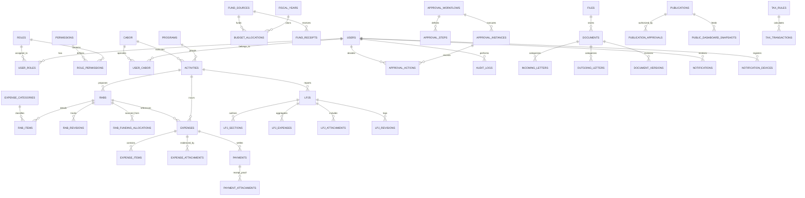
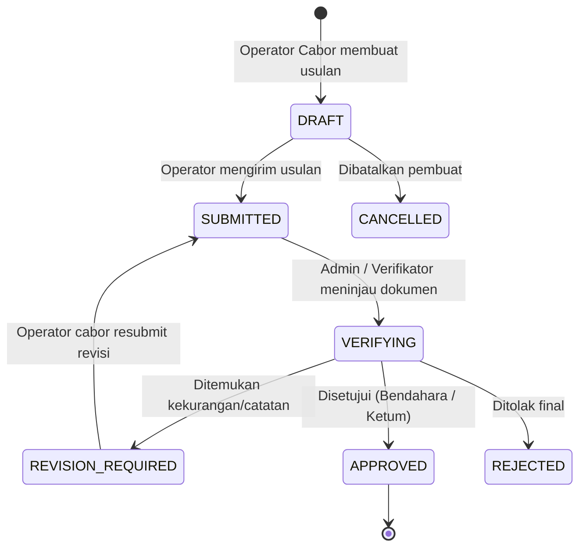
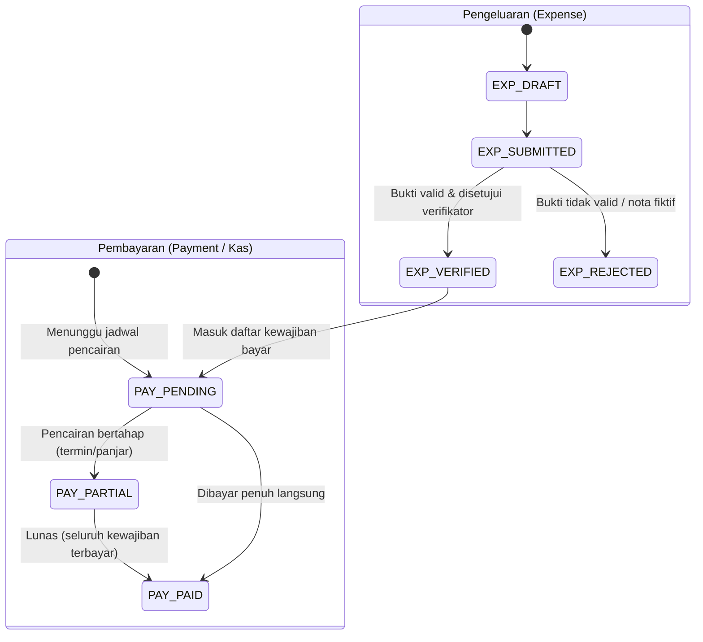
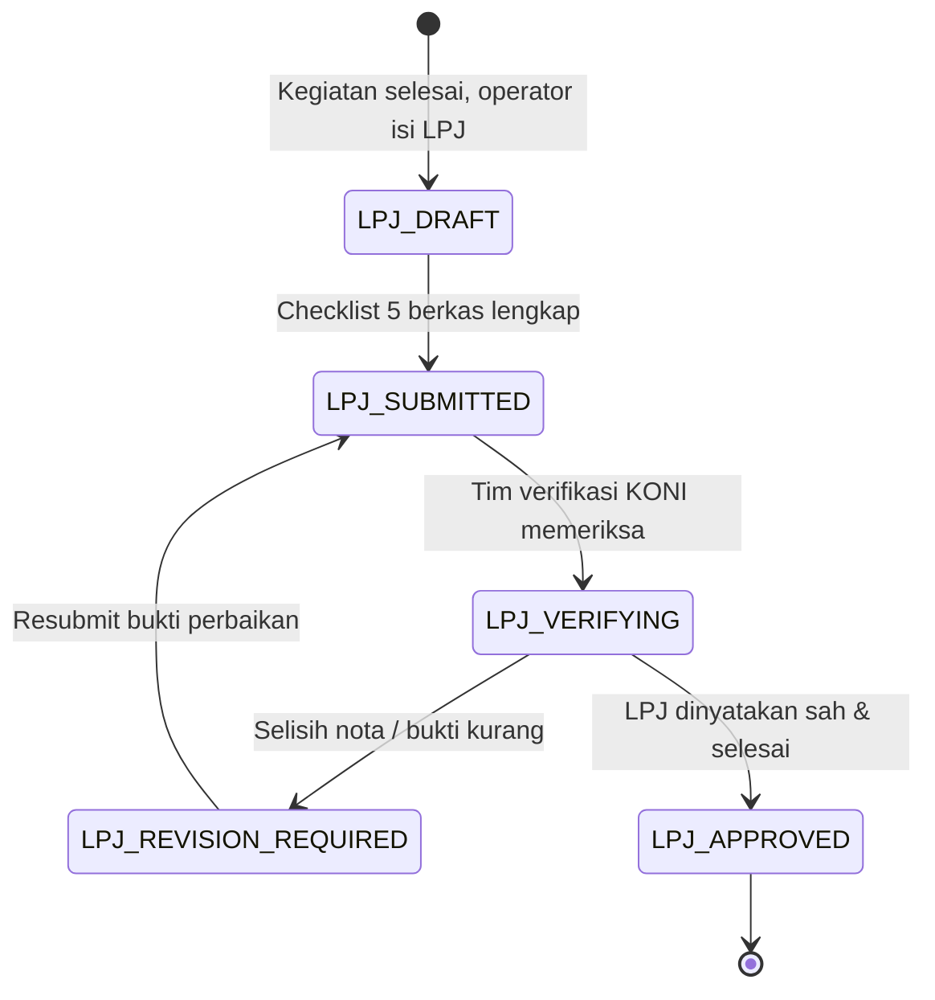

# SIKONI — Arsitektur Sistem, Desain Data, & Status Model
**Sistem Informasi KONI Surakarta**

Dokumen ini adalah cetak biru teknis resmi untuk mentransformasikan prototipe mockup SIKONI menjadi sistem enterprise monorepo multi-kanal.

---

## 1. Arsitektur Solusi & Folder Tree

Sistem mengadopsi pola **Modular Monolith** dengan satu backend API terpusat sebagai *single source of truth* untuk seluruh kanal:

```
SIKONI/
├── apps/
│   ├── api/                     # Backend NestJS + TypeScript (REST + OpenAPI)
│   │   ├── src/
│   │   │   ├── common/          # Guards (JWT, Role, CaborScope), Decorators, Interceptors
│   │   │   ├── modules/
│   │   │   │   ├── auth/        # Autentikasi, Password Hashing, Session
│   │   │   │   ├── users/       # Manajemen Pengguna, Role & Permissions
│   │   │   │   ├── cabor/       # Master Cabang Olahraga & User Cabor Assignment
│   │   │   │   ├── budget/      # Tahun Anggaran, Sumber Dana, Pagu & Alokasi
│   │   │   │   ├── rab/         # Usulan RAB, Item Biaya, Revisi, & Workflow
│   │   │   │   ├── expenses/    # Realisasi Pengeluaran, Item, Bukti Transaksi
│   │   │   │   ├── payments/    # Pembayaran Parsial, Rekonsiliasi, Bukti Bayar
│   │   │   │   ├── lpj/         # Penyusunan LPJ, Checklist, Komparasi RAB vs Realisasi
│   │   │   │   ├── approval/    # Engine Approval Matrix multi-step berdasar nominal
│   │   │   │   ├── documents/   # Arsip Dokumen, Surat Masuk, Surat Keluar
│   │   │   │   ├── incentives/  # Data Penerima Insentif Atlet/Pelatih/Ofisial
│   │   │   │   ├── tax/         # Rekap Pajak, PPh/PPN, Bukti Setor
│   │   │   │   ├── reports/     # Laporan & Agregasi Anggaran vs Realisasi
│   │   │   │   ├── public/      # Endpoint Portal Publik & Snapshot Transparansi
│   │   │   │   └── audit/       # Immutable Audit Trail & Log Transaksi
│   │   │   ├── main.ts
│   │   │   └── app.module.ts
│   │   ├── test/                # Unit test, E2E test, Cabor Isolation test
│   │   ├── package.json
│   │   └── tsconfig.json
│   │
│   ├── web/                     # Frontend Next.js (App Router) + TypeScript
│   │   ├── src/
│   │   │   ├── app/
│   │   │   │   ├── (public)/    # Kanal Publik: /, /transparansi, /cabor, /berita, /profil
│   │   │   │   ├── (auth)/      # Login Internal: /login
│   │   │   │   ├── admin/       # Kanal Admin: Dashboard, Keuangan, RAB, LPJ, Cabor, dsb.
│   │   │   │   └── layout.tsx
│   │   │   ├── components/      # UI Design System (Navy #142a43, Teal #168b8b, Gold #d7ac57)
│   │   │   │   ├── layout/      # Sidebar, Topbar, PublicHeader, PublicFooter, MobileFrame
│   │   │   │   ├── cards/       # KPI Card, Chart Card, Donut Card, Metric Line
│   │   │   │   ├── tables/      # DataTable reusable dengan filter, search, paginasi
│   │   │   │   └── forms/       # Stepper/Wizard RAB, Input Form Modal, File Uploader
│   │   │   ├── lib/             # API client, Decimal helper, format Rupiah
│   │   │   └── styles/          # Tailwind / CSS Custom Variables matching mockup
│   │   ├── package.json
│   │   └── tsconfig.json
│   │
│   └── mobile/                  # Aplikasi Android React Native Expo + TypeScript
│       ├── src/
│       │   ├── navigation/      # 5 Bottom Tab Navigasi: Beranda, Keuangan, Pengajuan, Notif, Akun
│       │   ├── screens/         # HomeScreen, FinanceScreen, SubmissionsScreen, RabWizard, ExpenseForm, LpjScreen
│       │   ├── components/      # Reusable Mobile Cards, KPI tiles, Status badges
│       │   ├── services/        # Offline draft storage & API synchronization
│       │   └── theme/           # Palette SIKONI Mobile
│       ├── package.json
│       └── app.json
│
├── packages/
│   ├── database/                # Prisma PostgreSQL Schema, Migrations, Seeders
│   │   ├── prisma/
│   │   │   ├── schema.prisma    # 40+ Tabel Relasional, Decimal(15,2), Indexes
│   │   │   ├── seed.ts          # Data inisialisasi master & simulasi mockup
│   │   │   └── migrations/
│   │   ├── package.json
│   │   └── tsconfig.json
│   │
│   └── shared/                  # Tipe data bersama, Enums, DTO, Rule Constants
│       ├── src/
│       │   ├── enums/           # RabStatus, ExpenseStatus, PaymentStatus, LpjStatus
│       │   ├── models/          # Entity interfaces
│       │   └── utils/           # Decimal-safe math functions
│       ├── package.json
│       └── tsconfig.json
│
├── docs/                        # Dokumentasi Desain, ERD, Security, Test Plan
├── mockup/                      # Aset asli prototype, index.html, & screenshot acuan
├── docker-compose.yml           # PostgreSQL, MinIO, API, Web deployment
└── package.json                 # Monorepo root
```

---

## 2. Diagram ERD (Entity Relationship Diagram)

Berikut rancangan relasi database domain minimum mencakup seluruh entitas yang disyaratkan:



---

## 3. Kamus Data Domain Minimum (Data Dictionary)

| Domain | Tabel | Deskripsi & Constraints |
|---|---|---|
| **Identity** | `users` | Akun pengguna (`id`, `username`, `email`, `password_hash`, `full_name`, `phone_number`, `is_active`, `mfa_secret`, `created_at`, `updated_at`, `deleted_at`). |
| | `roles` | Peran sistem: `SUPERADMIN`, `ADMIN_KONI`, `BENDAHARA`, `KETUA_UMUM`, `OPERATOR_CABOR`, `AUDITOR`. |
| | `permissions` | Kode izin granular (`cabor:read`, `rab:create`, `rab:approve_bendahara`, `expense:verify`, dsb). |
| | `role_permissions` | Relasi many-to-many role dan permission. |
| | `user_roles` | Relasi penugasan role ke user. |
| | `user_cabor` | Relasi penugasan user operator ke cabang olahraga spesifik (`user_id`, `cabor_id`, `is_primary`). Wajib untuk isolasi akses cabor. |
| **Organisasi & Pagu** | `cabor` | Master cabor: `code` (e.g. PASI, PBSI), `name`, `sport_category`, `leader_name`, `official_email`, `phone`, `status`, `athlete_count`. |
| | `fiscal_years` | Tahun anggaran: `year` (e.g. 2026), `total_pagu` (`Decimal(15,2)`), `start_date`, `end_date`, `is_active`. |
| | `fund_sources` | Sumber dana: `code`, `name` (Hibah Pemda, Bantuan Pembinaan, Sponsor, Lainnya). |
| | `fund_receipts` | Penerimaan dana masuk riil: `reference_no`, `fund_source_id`, `amount` (`Decimal(15,2)`), `received_date`, `status`, `proof_file_id`. |
| | `programs` | Program kerja KONI (Pembinaan Atlet, Penyelenggaraan Kompetisi, Operasional Sekretariat). |
| | `activities` | Kegiatan olahraga/organisasi turunan dari program. |
| | `expense_categories` | Kategori biaya (Honor/Insentif, Sewa Venue, Transportasi, Konsumsi, Perlengkapan). |
| | `budget_allocations` | Pagu alokasi per cabor / per program: `fiscal_year_id`, `cabor_id`, `program_id`, `allocated_amount` (`Decimal(15,2)`). |
| **RAB** | `rabs` | Usulan anggaran: `rab_number`, `activity_id`, `cabor_id`, `fiscal_year_id`, `name`, `description`, `location`, `start_date`, `end_date`, `total_amount` (`Decimal(15,2)`), `status` (`DRAFT`, `SUBMITTED`, `VERIFYING`, `REVISION_REQUIRED`, `APPROVED`, `REJECTED`, `CANCELLED`), `current_step_id`, `created_by_id`. |
| | `rab_items` | Rincian item biaya: `rab_id`, `expense_category_id`, `description`, `volume` (`Decimal(10,2)`), `unit`, `unit_price` (`Decimal(15,2)`), `total_amount` (`Decimal(15,2)`). |
| | `rab_revisions` | Log histori revisi RAB: `rab_id`, `revision_no`, `change_summary`, `snapshot_json`, `created_by_id`. |
| | `rab_funding_allocations`| Pemetaan alokasi sumber dana ke RAB. |
| **Realisasi & Bukti**| `expenses` | Realisasi pengeluaran: `expense_number`, `rab_id`, `activity_id`, `cabor_id`, `expense_date`, `description`, `amount` (`Decimal(15,2)`), `payment_method` (`ADVANCE_PANJAR`, `REIMBURSEMENT`, `DIRECT_PAYMENT`), `status` (`DRAFT`, `SUBMITTED`, `VERIFIED`, `REJECTED`), `verified_by_id`, `verified_at`. |
| | `expense_items` | Item pecahan nota pengeluaran. |
| | `expense_attachments` | Bukti fisik/invoice transaksi (file terenkripsi/private URL). |
| | `payments` | Pencatatan pembayaran: `payment_number`, `expense_id`, `payment_date`, `amount_paid` (`Decimal(15,2)`), `payment_reference`, `status` (`PENDING`, `PARTIAL`, `PAID`, `CANCELLED`), `disbursed_by_id`. |
| | `payment_attachments` | Bukti transfer/kuitansi bayar. |
| **LPJ** | `lpjs` | Dokumen pertanggungjawaban: `lpj_number`, `activity_id`, `cabor_id`, `submission_date`, `total_realized_amount` (`Decimal(15,2)`), `variance_amount` (`Decimal(15,2)`), `status` (`DRAFT`, `SUBMITTED`, `VERIFYING`, `REVISION_REQUIRED`, `APPROVED`, `REJECTED`). |
| | `lpj_sections` | Checklist 5 elemen wajib: Identitas, Realisasi vs RAB, Bukti Pengeluaran, Bukti Pembayaran, Dokumentasi Foto. |
| | `lpj_expenses` | Pemetaan pengeluaran yang dipertanggungjawabkan dalam LPJ. |
| | `lpj_attachments` | File laporan lengkap, foto kegiatan, absensi. |
| | `lpj_revisions` | Catatan koreksi pemeriksa dan perbaikan operator. |
| **Approval Engine**| `approval_workflows` | Definisi alur: `module_type` (`RAB`, `EXPENSE`, `LPJ`, `FUND_RECEIPT`), `name`, `is_active`. |
| | `approval_steps` | Urutan tahap persetujuan: `step_order`, `step_name`, `required_role_id`, `min_amount`, `max_amount`. |
| | `approval_instances` | Sesi aktif approval untuk entitas tertentu (`entity_type`, `entity_id`, `current_step_id`, `status`). |
| | `approval_actions` | Keputusan approval: `instance_id`, `step_id`, `actor_id`, `decision` (`APPROVE`, `REJECT`, `REQUEST_REVISION`), `comments`, `decided_at`. |
| **Audit & Dokumen**| `audit_logs` | Append-only immutable log: `user_id`, `action`, `resource_type`, `resource_id`, `ip_address`, `user_agent`, `payload_before`, `payload_after`, `created_at`. |
| | `files` | Metadata file di S3: `storage_key`, `original_name`, `mime_type`, `byte_size`, `is_private`. |
| | `documents` | Master arsip surat/berkas resmi. |
| | `incoming_letters` & `outgoing_letters` | Metadata surat masuk & keluar, perihal, disposisi. |
| **Publikasi & Pajak**| `publications` | Konten berita/informasi publik: `title`, `slug`, `content`, `status` (`DRAFT`, `APPROVED_FOR_PUBLICATION`). |
| | `public_dashboard_snapshots` | Agregat data publik (hanya angka total yang disahkan, tanpa detail rahasia cabor). |
| | `tax_rules` | Konfigurasi tarif pajak resmi (`tax_type`, `rate_percentage`, `description`). |
| | `tax_transactions` | Potongan PPh/PPN yang tercatat dari pengeluaran (`expense_id`, `tax_rule_id`, `taxable_base`, `tax_amount`, `deposit_proof_file_id`, `status`). |

---

## 4. Status Machine & State Transitions

### A. Status Model RAB (Rencana Anggaran Biaya)

*Aturan Kritis:*
1. **Maker Invariant:** Pembuat RAB (`created_by_id`) tidak diizinkan menjadi approver pada setiap tahap approval transaksi tersebut.
2. **Pagu Check:** Pengajuan RAB tidak boleh melebihi sisa alokasi pagu cabor terkait pada tahun anggaran aktif.

### B. Status Model Realisasi Pengeluaran (Expense) vs Pembayaran (Payment)

*Prinsip Keuangan:*
- Pengeluaran yang berstatus `VERIFIED` **bukan berarti telah dibayar**.
- Realisasi yang diakui dalam laporan keuangan hanya yang berstatus `VERIFIED`.

### C. Status Model LPJ (Laporan Pertanggungjawaban)

*Prinsip LPJ:*
- LPJ tidak dapat disetujui jika ada pengeluaran terkait kegiatan yang belum berstatus `VERIFIED` atau terdapat selisih pengembalian sisa panjar yang belum tuntas.

